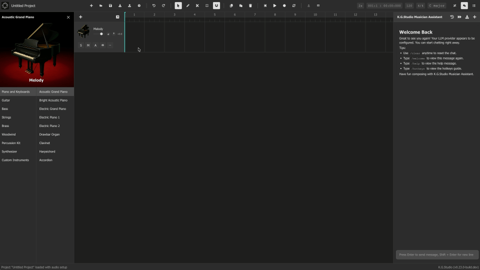
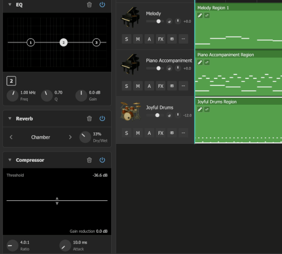
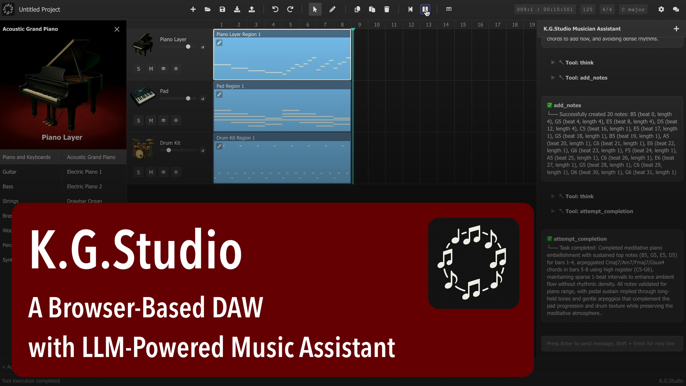
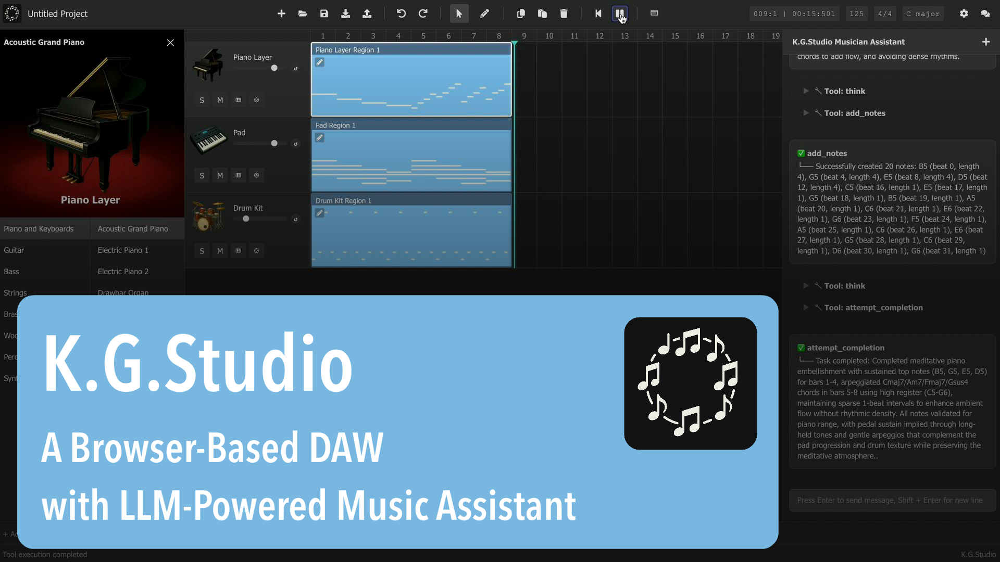

[English](./README.md) | [Français](./README-fr.md) | [简体中文](./README-zh_cn.md) | 繁體中文

<div align="center">
  
</div>

# K.G.Studio — 一款基於瀏覽器的 DAW，並內建 AI 助手

<div align="center">
  <h3><a href="https://kgaudiolab.github.io/kgstudio"><b>◀ 立即在瀏覽器中線上使用 K.G.Studio ▶</b></a></h3>
</div>

## 什麼是 K.G.Studio？

K.G.Studio 是一款輕量、現代化的 DAW，完全執行於瀏覽器中，並以 **K.G.Studio 音樂創作助手** 為核心。它提供基於 Tone.js sampler 的真實樂器回放、Piano Roll 編輯器、支援完整復原/重做的音軌與區域管理、基於 OPFS（Origin Private File System）的專案持久化、可設定的設定面板，以及可執行工具的內建 AI 助手。

**K.G.Studio 音樂創作助手** 幫助您透過自然語言創作旋律、構建和弦進行，以及編輯音軌和 MIDI 音符。您可以接入外部 LLM API，或使用內建的 **Gemma 4 E4B** 作為後備方案，藉助 WebGPU 加速完全在瀏覽器中執行，無需 API Key。

<div align="center">
  
</div>

### AI 音樂工具

這兩項工具均可在支援的硬體上藉助 **WebGPU 加速**，完全在瀏覽器內執行，MIDI 和音訊處理均在本地完成。

- **人性化** — 使用 [AIRE](https://huggingface.co/KGAudioLab/instrument-aire-models)，根據音樂角色和情緒為弦樂、銅管和木管生成富有表現力的 MIDI 控制器曲線。塑造調變、氣息、音量或表情，同時保留音符的時序和力度。
- **音軌分離** — 將音訊分離為人聲與伴奏，或人聲、鼓、貝斯及其他樂器。試聽分離結果，並直接匯入編曲繼續編輯。

## 最新更新

- **2026.10.18**: 新增面向外部 AI Agent 的本地 MCP 支援：
  - **外部 Agent 工具** — 連接 Codex、Claude Code、OpenCode 或 Pi 來編輯音樂；切換目前的 Agent 模式時，可用工具會自動更新。
  - **專案管理** — 直接透過已連線的 Agent 查看目前專案資訊，以及建立、列出、儲存或開啟專案。
  - **本地執行與控制** — 使用 `npm run dev:mcp` 或 `npm run preview:mcp`，並保持 K.G.Studio 在瀏覽器中開啟。請求預設停用，請在**設定 → MCP** 中啟用。

- **2026.10.11**: 新增音軌效果器（FX），用於音色塑造與混音：
  - **靈活的效果鏈** — 為 MIDI 和音訊軌加入均衡器（EQ）、混響、壓縮器和限制器，支援參數調整、效果旁路、拖曳排序及完整復原/重做。
  - **即時視覺回饋** — 透過互動式頻率響應曲線和即時頻譜調整 EQ，並在播放時監測壓縮器與限制器的電平和增益衰減。
  - **可重用的 FX 設定** — 儲存和載入效果鏈預設，在音軌間複製單個效果器，並在複製音軌時選擇包含 FX。效果器設定隨專案一同儲存。

<div align="center">
  
</div>

- **2026.10.10**: 新增富有表現力的 MIDI 人性化功能，並擴展 AI Agent 編輯能力：
  - **AIRE 人性化** — 藉助 WebGPU 加速，完全在瀏覽器中為弦樂、銅管和木管生成可編輯的 MIDI 表現曲線。可選擇音樂角色、情緒及目標控制器（CC1、CC2、CC7 或 CC11），並支援可選的力度條件輸入和曲線簡化。音符的時序和力度保持不變。
  - **進階 Agent 模式** — 使用結構化 JSON 音樂工具和精確的 tick 時序進行細緻的編曲編輯。助手可更新或刪除音量、聲像、彎音及 MIDI CC 自動化，並支援將批次控制點更新作為一次可復原操作。結構化的音軌和樂器列表提供更豐富的專案上下文。

- **2026.07.18**: 推出強大的 MIDI 編曲與編輯新工作流：
  - **靈活且感知調性的移調能力** — 可在音軌或區域層級獨立設定移調，支援最高三個八度的升降，並可選擇跟隨調號變化。當專案調性或調號區域發生變化時，系統亦可自動移調和弦軌內容，在整個編曲中保持一致的和聲意圖。
  - **MIDI 參考模式** — 可在鋼琴卷簾中將第二個 MIDI 區域作為唯讀參考層疊加顯示，並與時間線精準對齊；編輯目前聲部時，可以更高效地協調旋律、和聲、聲部配置與節奏關係。
  - **其他體驗增強** — 優化播放頭的可見性與導覽體驗，支援全域軌固定顯示和可設定的音軌複製，改進五線譜中感知調性的等音拼寫，並完善編輯器選單的層級顯示。

- **2026.07.12**: 全面增強 MIDI 創作、編輯與播放工作流：
  - **智能琶音器** — 從範例音符中學習模式，並根據和弦或 MIDI 生成變奏，同時保留原始半音音高，支援原子化復原。
  - **更高效的 MIDI 編輯與匯出** — 可在自訂範圍內按音高層級選取音符，並將單個區域、完整音軌或整個專案匯出為標準 MIDI 檔案。
  - **持久化自訂樂器** — 使用 WAV 或 MP3 取樣建立可重用樂器，支援逐音高對應、試聽、可設定音域、內建後備樂器，並無縫整合播放與 MIDI 匯出。
  - **更專注的編輯體驗** — 鋼琴卷簾現可停靠在時間線下方並調整高度；水平捲動時，音軌控制區仍會固定顯示。
  - **更可靠的播放與記譜** — 獨奏現在可覆蓋靜音狀態，音訊軌可在播放期間即時取消靜音，低音譜號休止符也能顯示在正確位置。

- **2026.06.05**: 大幅擴展 **K.G.Studio 音樂創作助手**，升級為完整的專案級 AI Agent：
  - **音軌管理工具** — Agent 現在無需選取區域，即可列出、建立、更新和刪除音軌，以及瀏覽所有可用樂器。
  - **全域軌工具** — 完整讀取/寫入/刪除四條全域軌：**和弦進行**、**速度（BPM）**、**調號** 和 **Marker**。Agent 可在一次對話中重構整首編曲的和聲與節奏骨架。
  - **工具確認機制** — 寫操作在執行前會在聊天中顯示確認步驟，讓您在修改生效前有機會審查。
  - **Agent 待辦清單** — 助手現在會在聊天中維護內聯任務清單，以即時快照卡片的形式呈現，讓多步驟計劃一目了然。
  - **對話歷史** — 聊天會話會按專案持久化保存，並可跨頁面重新整理恢復。
  - **自動上下文壓縮** — 當對話接近上下文限制時，舊訊息會自動摘要壓縮，保證長對話持續運作。
  - **高效 Agent 模式** — 為較小/本地語言模型提供精簡提示詞與工具集，使用 Local Browser LLM 時自動啟用。

查看完整版本歷史，請參閱 [**發佈說明**](./docs/RELEASE_NOTES.md)。

## 專案狀態

**K.G.Studio 是一個仍處於早期開發階段的實驗性專案。** 我們正在探索如何將 AI agent 與 LLM 融入音樂製作工作流，本質上是在建構一種面向 DAW 的「Cursor 或 Claude Code」體驗。

該專案關注 AI 與人類協作如何增強音樂創作過程，從智慧和聲建議到自動化編輯任務都在探索範圍內。作為實驗平台，專案會頻繁變化，功能將持續演進，並且在我們推進 AI 輔助音樂製作邊界的過程中，偶爾出現不穩定情況也是可以預期的。

## 演示影片

<div align="center">
  <table>
    <tr>
      <td align="center">
        <a href="https://youtu.be/FXgihfAH2vc" target="_blank">
          
        </a>
        <br><b>短演示（僅 DAW）</b>
      </td>
      <td align="center">
        <a href="https://www.youtube.com/watch?v=W25buhoeYN0" target="_blank">
          
        </a>
        <br><b>完整演示（僅 DAW）</b>
      </td>
    </tr>
  </table>
</div>

## 快速開始

### 設定 K.G.Studio 音樂創作助手

使用 K.G.Studio 音樂創作助手有兩種方式：一種是 **Local LLM (Browser)**，完全在瀏覽器中執行，無需 API Key、無需費用，且資料不會離開您的裝置；另一種是使用 **外部 LLM 提供方**，以獲得更高品質的回覆。

#### 方案 A：Local LLM (Browser) — 無需 API Key ✦

K.G.Studio 可以藉助 WebGPU 加速，在瀏覽器中直接執行 **Gemma 4 E4B**。不會產生 API 呼叫，不會產生費用，您的資料也不會離開本機。

  - 點擊這裡開始線上使用應用：[K.G.Studio (kgaudiolab.github.io/kgstudio)](https://kgaudiolab.github.io/kgstudio)
  - 在 **設定 ⚙️ → 音樂創作助手 → LLM 提供方** 中選擇 **本地 LLM（瀏覽器）**（預設選項）。
  - 第一次開啟聊天時，模型（約 2.8 GB）會自動下載，並快取在瀏覽器的 OPFS（Origin Private File System）中，後續啟動幾乎可即時使用。
  - 您也可以選擇設定 **上下文長度**（32k / 64k / 128k tokens）；數值越大，對顯存要求越高。
  - 現在就可以開始聊天。除首次下載模型外，無需 Key、無需帳號，也無需持續連網。

**Local LLM 的要求：** 需要支援 WebGPU 的瀏覽器（Chrome 113+ 或 Edge 113+），並執行在安全上下文中（HTTPS 或 localhost）。推薦硬體為至少 8 GB 顯存的 GPU，或至少 16 GB 統一記憶體的系統。

> **注意：** 本地模型的品質無法與 GPT 或 Claude 系列商業模型相比。對於複雜的音樂編輯任務，外部提供方通常會產生更好的結果。

#### 方案 B：外部 LLM 提供方（更高品質）

  - 點擊這裡開始線上使用應用：[K.G.Studio (kgaudiolab.github.io/kgstudio)](https://kgaudiolab.github.io/kgstudio)
  - [取得 OpenRouter API Key](https://openrouter.ai/keys)（需要一個 OpenRouter 帳號）。
  - 在 **設定 ⚙️ → 音樂創作助手 → LLM 提供方** 中選擇 **OpenAI Compatible**。
  - 在 **LLM 提供方（OpenAI 相容） → 密鑰** 中貼上您的 Key。（注意：在非 localhost 環境中，出於安全原因，您的 Key 預設不會被持久化；您可以在設定中啟用「Persist API Keys on Non-Localhost」以允許持久化，但這可能增加 XSS 風險。）
  - 在 **LLM 提供方（OpenAI 相容） → 模型** 中輸入您從 [OpenRouter 模型頁面](https://openrouter.ai/models) 選擇的模型 ID。使用前請查看其價格和資料政策；K.G.Studio 與 OpenRouter 或任何模型提供方 **沒有關聯關係**。
  - 在 **LLM 提供方（OpenAI 相容） → 基礎 URL** 中輸入 `https://openrouter.ai/api/v1`。

**提示：**
- 您也可以使用官方 OpenAI API、其他 OpenAI 相容服務，或自行託管的 LLM 伺服器（如 Ollama、vLLM）。請注意，不同模型的品質差異較大，並非所有模型都同樣適合音樂編輯任務。我們推薦 GPT 6.1 Sol，因為它在品質與成本之間取得了良好的平衡。
- 如果您已訂閱 OpenAI 或其他 LLM 提供方，可以使用 [CLIProxyAPI](https://github.com/router-for-me/CLIProxyAPI) 執行一個本地代理伺服器，透過現有訂閱轉發請求，而無需另外準備 API Key。

### 基本 DAW 操作
  - 在音軌上雙擊（或按住 Ctrl/Cmd 並點擊）可建立區域。
  - 拖動區域邊緣可調整長度；拖動區域主體可移動。
  - 點擊區域左上角的小鉛筆即可開啟鋼琴卷簾。
  - 在鋼琴卷簾中，雙擊（或 Ctrl/Cmd+點擊）可建立音符。
  - 單擊可選取；Shift+單擊可多選；拖曳可框選。
  - 拖動音符邊緣可調整長度；拖動音符主體可移動已選音符。
  - 使用鋼琴卷簾工具列右上角的 Snapping 功能可將編輯量化到網格。

### 使用 K.G.Studio 音樂創作助手
  - 選取您希望助手處理的音樂區域，在聊天框中輸入提示詞；按 Enter 傳送，按 Shift+Enter 插入換行。
  - agent 會自動處理您的請求，並呼叫工具，在所選區域範圍內執行修改。某些任務可能需要一輪或多輪對話才能完成。
  - 請注意，AI 也可能出錯，因此您應始終檢查結果，並在必要時自行調整。您也可以透過復原/重做回退修改。
  - 點擊「+」按鈕或輸入 `/clear` 指令可清空聊天歷史。

### 更多說明

您可以在[這裡](./docs/USER_GUIDE.md)查看詳細使用者指南。

### 亮點功能
- **K.G.Studio 音樂創作助手**：與由 LLM 驅動的 AI agent 進行對話；它會自動執行工具，對您所選區域內的音樂內容進行編輯。
- **瀏覽器內嵌 LLM，無需 API Key**：透過 WebGPU（LiteRT-LM）在瀏覽器中直接執行 **Gemma 4 E4B**。無 API 呼叫、無費用、資料不離開您的裝置。模型只需下載一次，隨後會快取在本地。
- **瀏覽器內嵌分軌，無需伺服器**：使用 **UVR-MDX-NET-Inst_HQ_3**（2-stem：Vocals / Instrumental）或 **Demucs htdemucs_4s**（4-stem：Vocals / Drums / Bass / Others）將任意音訊區域拆分為 stems。兩者都完全在瀏覽器中透過 ONNX Runtime WebGPU 執行。
- **音訊和弦檢測**：為音訊區域開啟 Piano Roll 後執行 **Detect Chords**，即可透過零依賴 FFT 流水線自動分析錄音並填充全域 Chord Track，同時支援靈敏度、穩定性和七和弦檢測等設定。
- **帶自動對齊拍點的速度檢測**：在 Piano Roll 工具列執行 **Detect Tempo**，即可分析音訊區域的 BPM，並可選擇自動重新對齊專案的 Tempo Track。
- **全域軌系統**：四條持久存在的全域軌 **Marker**、**Tempo**、**Key Signature** 和 **Chord** 共同提供專案級結構，所有功能（播放時序、和弦檢測、五線譜顯示）都會參考它們。
- **多種 LLM 提供方**：支援 OpenAI、Claude / Gemini（透過 OpenRouter）、OpenAI 相容服務（Ollama、vLLM 等），或內建的本地瀏覽器 LLM，無需 Key。
- **音軌與區域編輯**：支援新增/重排音軌、建立/移動/縮放區域、套索多選、批次移動/縮放、合併與拆分區域，以及完整復原/重做。
- **Piano Roll**：支援音符、pitch bend 和 MIDI CC 自動化軌；支援基於 VexFlow 的五線譜視圖；支援音訊到 MIDI 參考用途的頻譜疊加層。
- **真實樂器**：基於 Tone.js 的 sampler，搭配高品質 FluidR3 soundfonts。您還可以直接從麥克風錄製到音訊軌。
- **智慧和弦助手**：基於功能和聲（T/S/D）提供即時和弦建議，並支援可視預覽與一鍵建立和弦。
- **兼顧持久化與隱私**：專案和設定完全儲存在您的瀏覽器中（OPFS / IndexedDB）。專案本身不依賴第一方伺服器。

如需更深入的技術概覽，請參閱 [overview.md](./docs/technical/overview.md)。

## 開始使用

### 或者在本地複製並執行：
```bash
# 請確認已安裝 Node.js 24.22.0 LTS (npm 11.19.1)
# 複製倉庫
git clone https://github.com/KGAudioLab/KGStudio {your-local-path}
cd {your-local-path}

# 安裝依賴
npm ci

# 啟動開發伺服器
npm run dev
```

### 本地 MCP 伺服器（Codex、Claude Code、OpenCode 和 Pi）

K.G.Studio 可以透過 **Streamable HTTP，使用 MCP `2025-11-25` 版本**向外部 MCP 客戶端提供音樂工具。

**必須同時滿足以下兩個條件：**

1. **在您的本地電腦上**執行已啟用 MCP 的 K.G.Studio 伺服器。
2. **在瀏覽器中**開啟本地 K.G.Studio 網頁，並保持該分頁開啟。工具使用該分頁中的目前專案、選取範圍和復原歷史。僅啟動伺服器並不足夠。

安裝依賴後，選擇以下其中一種方式：

```bash
# 開發模式：支援熱更新的 Vite + MCP
npm run dev:mcp

# 或提供建置後的檔案 + MCP（先執行建置）
npm run build
npm run preview:mcp
```

| 命令 | 在瀏覽器中開啟的網頁 | MCP 端點 |
| --- | --- | --- |
| `dev:mcp` | `http://127.0.0.1:5173/kgstudio/` | `http://127.0.0.1:5173/mcp` |
| `preview:mcp` | `http://127.0.0.1:4173/kgstudio/` | `http://127.0.0.1:4173/mcp` |

這些命令只會綁定回環介面，如果連接埠已被佔用則會啟動失敗。終端機會顯示網頁 URL 和 MCP 端點。**無需權杖、環境變數或身分驗證標頭。** 在 MCP 客戶端中設定本地 HTTP 端點即可；請求仍受回環介面和允許的本地來源限制。

對於使用 JSON 設定 MCP 的客戶端，HTTP 伺服器項目通常如下（請按客戶端調整外層設定結構）：

```json
{
  "mcpServers": {
    "kgstudio": {
      "type": "http",
      "url": "http://127.0.0.1:5173/mcp"
    }
  }
}
```

對於 Codex，請將以下內容加入本地 `config.toml`：

```toml
[mcp_servers.kgstudio]
url = "http://127.0.0.1:5173/mcp"
```

使用 `preview:mcp` 時，請改用連接埠 `4173`。對於 OpenCode V2，請使用該 URL 設定 `remote` 伺服器，並將協定保持為 `legacy`（`oauth: false` 可停用不必要的 OAuth 探索）。Claude Code 和 Pi 可以直接使用 HTTP URL，無需身分驗證；具體設定方式請參閱各客戶端的文件。

**工具與模式切換：**

- MCP 遵循應用程式**實際生效的 Agent 模式**（常規、進階或高效）。與內部助手一樣，使用 Local LLM (Browser) 提供方時會強制啟用高效模式。
- 切換模式會更新工具目錄並傳送 MCP 工具清單變更通知，無需重新啟動伺服器。如果客戶端未自動重新整理，請重新連線。
- 如果工具在不同模式下的介面不相容，其名稱會包含模式前綴，例如 `regular_add_notes`、`advanced_add_notes` 和 `efficient_add_notes`。進階模式工具使用**每四分音符 960 tick** 的時間單位；常規／高效模式工具以四分音符為時間單位。通用工具保留原名。
- `update_todo_list` 專供 K.G.Studio 內部助手使用，絕不會透過 MCP 提供。
- 只有目前瀏覽器分頁已連接本地 MCP 服務時，才會顯示 MCP 設定頁面；靜態託管或服務無法使用時會隱藏該頁面。**MCP 請求預設停用。** 請在**設定 → MCP → 允許 MCP 請求**中選擇**啟用**，以允許外部工具操作。此選擇會儲存在目前瀏覽器中。停用時，請求會傳回錯誤，要求呼叫方告知使用者啟用 MCP，同時會彈出提示，指引使用者前往設定 → MCP；提示視窗開啟期間，重複請求不會產生更多彈窗。啟用後，請求無需逐次確認，與內部助手的批准設定互相獨立。停用 MCP 會令排隊中的呼叫失效。
- 音樂編輯操作使用現有命令系統，支援與對應應用程式內工具相同的復原行為。
- 同一時間只能有**一個瀏覽器分頁**控制 MCP。其他分頁會顯示狀態訊息；請先關閉目前控制 MCP 的分頁，再重新載入希望連線的分頁。關閉該分頁後，工具將無法使用。瀏覽器暫停分頁可能導致執行延遲。
- 呼叫會在兩分鐘後到期。如果請求逾時或連線中斷，請先檢查專案，再重試編輯操作，因為已開始執行的編輯可能已完成。如果模式或專案在執行前發生變化，待處理的呼叫會被拒絕。

**MCP 專用專案工具**在所有 Agent 模式下均可使用：

| 工具 | 行為 |
| --- | --- |
| `get_current_project_info` | 讀取目前專案的名稱、已儲存快照狀態、音樂設定、音軌數量和實際生效的模式。 |
| `create_project` | 必須提供 `name`。建立並啟用未儲存的新專案，捨棄目前未儲存的變更。名稱無效、使用保留名稱 `Untitled Project` 或儲存空間中已存在同名專案時傳回錯誤。 |
| `list_projects` | 列出已儲存且未刪除的專案，以及建立／更新時間。 |
| `save_project` | 使用目前名稱原樣儲存，不重新命名或自動加入後綴。儲存 `Untitled Project` 或覆寫其他專案時傳回錯誤。 |
| `open_project` | 必須提供 `name`。按完整名稱啟用已儲存的專案，捨棄目前未儲存的變更。專案不存在、已刪除或無法載入時傳回錯誤。 |

專案儲存在控制 MCP 的瀏覽器的 OPFS 中。不同瀏覽器設定檔、主機名稱或連接埠（包括開發模式和預覽模式）可能擁有各自獨立的專案庫。建立／開啟專案會重設編輯器和復原歷史；捨棄的變更無法復原。切換專案前請先停止錄製。建立專案不會自動儲存，請呼叫 `save_project` 將其持久化。

外部客戶端必須在同一台電腦上執行，或能夠存取其回環介面；雲端 Agent 無法直接存取此 localhost 端點。執行 MCP 工具不需要 K.G.Studio 的 LLM API Key，外部 Agent 會使用自己的模型。

**仍然支援靜態託管。** 常規的 `dev`、`build` 和 `preview` 命令不會啟用 MCP 端點。`npm run build` 仍會產生可獨立部署到 GitHub Pages 等靜態託管服務的 `dist/`，GitHub Pages 部署工作流程保持不變。公開網頁不會連接 localhost。只有已啟用 MCP 的本地命令才會提供這個可選伺服器。

## 設定

K.G.Studio 會從 `./public/config.json` 載入預設設定（內部也提供回退預設值），並透過 `ConfigManager` + IndexedDB 將使用者修改持久化到瀏覽器中。IndexedDB 是瀏覽器在您裝置上的本地資料庫；資料不會離開您的機器，如果您清除此站點的資料，它也會被清除。請透過應用程式內的設定面板修改設定。

- **通用**
  - Soundfont 基礎 URL（樂器採樣 CDN）
- **音樂創作助手**
  - LLM 提供方：OpenAI，或 OpenAI 相容服務
  - 目前所選提供方對應的 API Key 與模型
  - 在非 localhost 環境持久化 API Key：啟用後，可在非 localhost 環境中持久化 API Key（屬於安全風險自擔選項，不建議在共享或生產環境中開啟）
  - OpenAI 相容服務的基礎 URL（適用於自託管閘道）
- **行為**
  - 啟動時預設開啟聊天框
- **模板**
  - AI 助手使用的自訂指令

### 連線性與隱私

- K.G.Studio 完全在客戶端執行。執行應用不需要任何第一方伺服器。
- 專案和音訊檔案儲存在瀏覽器的 OPFS（Origin Private File System）中；設定儲存在 IndexedDB 中。所有資料都留在您的裝置上。
- 網路存取僅用於：
  - 從設定的 soundfont CDN 下載樂器採樣
  - 與您選擇的 LLM 提供方通訊（例如 OpenAI 或 OpenAI 相容服務）
  - 透過 `dev:mcp` 或 `preview:mcp` 明確啟用後，與本地 MCP 橋接服務通訊，讓外部 Agent 能夠使用瀏覽器中的音樂工具
- 除上述情況外，應用均可在本地工作。如果您阻止採樣或 LLM 端點，應用仍可載入；受影響的回放和 AI 功能需要這些端點可用。
- 出於安全考量，當應用執行在非本地主機環境中時，我們預設不會將您的 API Key 持久化到 IndexedDB（以降低 XSS 風險）。這表示您每次啟動 K.G.Studio 時都需要重新輸入。如需在非本地主機環境中啟用持久化，請在設定中開啟「Persist API Keys on Non-Localhost」（不建議在共享或生產環境中啟用）。

## 使用應用

您可以在[這裡](./docs/USER_GUIDE.md)查看詳細使用者指南。

- 音軌
  - 在軌道資訊面板中新增、重新命名和重排音軌。
  - 透過樂器按鈕（鋼琴圖示）切換樂器；可調整 Solo（S）、Mute（M）和 Volume。
  - 透過音軌設定選單刪除音軌（位於樂器按鈕右側）。

- 區域
  - 建立區域：使用 Pointer 工具時可雙擊，或按住 Ctrl/Cmd 再點擊；使用 Pencil 工具時單擊即可。
  - 移動/縮放：拖動區域主體可移動，拖動邊緣可調整長度。
  - 透過區域左上角的小鉛筆開啟 Piano Roll。

- 鋼琴卷簾（MIDI 音符）
  - 工具：Select 與 Pencil。
  - 建立音符：在 Select 模式下雙擊或 Ctrl/Cmd+點擊；在 Pencil 模式下單擊。
  - 選取音符：單擊；Shift+單擊多選；拖曳框選。
  - 移動/縮放：拖動音符主體可移動已選音符；拖動邊緣可調整長度。
  - **五線譜視圖**：可在鋼琴卷簾工具列中切換 Piano Roll 與 Staff Notation 視圖。支援自動譜號選擇、調號顯示、符槓分組、連音線和可設定量化。啟用 **Track Scope** 後會將整條音軌上的所有區域連續渲染為譜面。
  - **自動化軌道**：可在鋼琴網格下方的可編輯區域中繪製和編輯 pitch bend 與 MIDI CC 曲線（Modulation、Breath、Volume、Expression、Sustain）。
  - **頻譜模式**：可在鋼琴卷簾中查看音訊區域的頻譜，並將其作為編輯 MIDI 音符時的參考層。
  - 可透過 X 或 ESC 關閉鋼琴卷簾視窗。

- 智慧和弦助手（新增於 2025-12-15）
  - 在鋼琴卷簾工具列中啟用和弦指導：選擇 T（Tonic）、S（Subdominant）或 D（Dominant）功能。
  - 將滑鼠懸停在任意琴鍵上時，會以紅色高亮顯示與上下文相關的和弦建議，並匹配您目前選擇的調號與調式。
  - 按 Tab 可在同一和聲功能下循環切換不同和弦轉位。
  - 雙擊（或 Ctrl/Cmd+點擊）高亮和弦可一次性建立整組音符。
  - 和弦長度會自動匹配您最近編輯的音符長度，以保持節奏一致。

- 吸附與量化
  - 在右上角的 NO SNAP 選單中設定吸附。
  - 使用 Qua. Pos.（起始）和 Qua. Len.（長度）進行量化。

- 播放與播放頭
  - 可透過工具列回到開頭，並執行 Play/Pause。
  - 在主時間網格點擊小節編號可設定播放頭；在鋼琴卷簾中點擊頂部時間軸也可設定，並遵守目前吸附設定。
  - BPM、拍號和調號都可以透過工具列中的數值進行修改。

## 鍵盤快捷鍵

- 主介面
  - 播放/暫停：Space
  - 復原 / 重做：Ctrl/Cmd+Z / Ctrl/Cmd+Shift+Z
  - 複製 / 剪下 / 貼上：Ctrl/Cmd+C / Ctrl/Cmd+X / Ctrl/Cmd+V
  - 儲存：Ctrl/Cmd+S
  - 按住以建立區域：Ctrl/Cmd
- 鋼琴卷簾
  - 工具：Select（Q）、Pencil（W）
  - 按住以建立音符：Ctrl/Cmd
  - 吸附：1(None), 2(1/4), 3(1/8), 4(1/16)
  - 位置量化：5(1/4), 6(1/8), 7(1/16)
  - 長度量化：8(1/4), 9(1/8), 0(1/16)

## AI 助手

### 使用 K.G.Studio 音樂創作助手

- 請先按照前文說明完成 LLM 提供方設定。
- 您可以在右側找到 K.G.Studio 音樂創作助手聊天框。如果目前未顯示，可點擊工具列中的 Chat 🗨️ 按鈕開啟。
- 選取您希望助手處理的區域，在聊天框中輸入提示詞；按 Enter 傳送，按 Shift+Enter 插入換行。
- agent 會自動處理您的請求，並呼叫工具，在所選區域範圍內執行修改。某些任務可能需要一輪或多輪對話才能完成。
- 請注意，AI 也可能出錯，因此您應始終檢查結果，並在必要時自行調整。您也可以透過復原/重做回退修改。
- 點擊「+」按鈕或輸入 `/clear` 指令可清空聊天歷史。

### 設定您的 LLM 提供方

進入 **設定 ⚙️ → 音樂創作助手 → LLM 提供方**。根據您選擇的提供方，您需要填寫對應的 API Key，並在需要時填寫自訂基礎 URL（適用於 Ollama、OpenRouter 等非官方 OpenAI 相容服務）。

注意：由於部分提供方存在 CORS 限制，Google Gemini 和 Anthropic Claude 目前僅支援透過 OpenRouter 使用。

### 使用 OpenAI 模型

1. 在 [**OpenAI**](https://platform.openai.com/account/api-keys) 取得 OpenAI API Key。您可能需要先註冊帳號並新增付款方式，才能生成 API Key。
2. 開啟 **設定 ⚙️ → 音樂創作助手**，點擊 **LLM 提供方（OpenAI 相容）** 下的 **OpenAI** 預設。它會填寫連線欄位並切換至 **OpenAI 相容** 模式。
3. 在 **LLM 提供方（OpenAI 相容）→ 密鑰** 中輸入您的 API Key。
4. 預設會將模型設為 `gpt-6.1-sol`，您也可以填寫帳戶可用的其他模型。

可用預設包括 OpenAI、Claude（透過 OpenRouter）、OpenRouter、Ollama、llama.cpp 和 CLIProxyAPI。點擊預設會替換密鑰、基礎 URL 和模型，並切換至 OpenAI 相容模式。對於受支援的 ChatGPT 或 Claude 訂閱，[CLIProxyAPI](https://github.com/router-for-me/CLIProxyAPI) 可提供本地相容連線，使用訂閱所提供的模型存取權限。所有預設都會清空密鑰。如果需要驗證，請輸入提供方或伺服器的密鑰。

### 使用 OpenRouter

OpenRouter 是一個統一接入平台，可讓您存取來自多個提供方的大量語言模型，便於比較並找到最適合您需求的模型。

1. 在 [**OpenRouter**](https://openrouter.ai/keys) 取得 API Key。需要註冊；若使用付費模型，可能還需要綁定付款方式。
2. 開啟 **設定 ⚙️ → 音樂創作助手**，點擊 **LLM 提供方（OpenAI 相容）** 下的 **OpenRouter** 預設。
3. 在 **LLM 提供方（OpenAI 相容） → 密鑰** 中輸入您的 API Key。
4. 在 [**OpenRouter 模型頁面**](https://openrouter.ai/models) 瀏覽可用模型，並比較其價格和功能。
   **注意：** 不同模型提供方的資料保留與隱私政策可能不同，請在使用前自行查看。
5. 在 **LLM 提供方（OpenAI 相容） → 模型** 中輸入您所選的模型名。
6. 在 **LLM 提供方（OpenAI 相容） → 基礎 URL** 中填入 `https://openrouter.ai/api/v1`。

您也可以在 [OpenRouter 模型頁面](https://openrouter.ai/models) 瀏覽目前可用的免費模型。可用性會隨時間變化；K.G.Studio 不再推薦用於音樂編輯的特定免費模型。

### 關於 agent 與 LLM 提供方

出於安全考量，當您從非本地主機環境使用 K.G.Studio 時，API Key 預設不會持久化到 IndexedDB 中；這表示您每次啟動 K.G.Studio 時都需要重新輸入。如需在非本地主機環境中啟用持久化，請在設定中開啟「Persist API Keys on Non-Localhost」（不建議在共享或生產環境中啟用）。

K.G.Studio 不提供也不託管上述任何模型，也不隸屬於任何模型提供方。所有資料都儲存在您的本地裝置中；K.G.Studio 不會蒐集或傳輸您的資料。若您向第三方模型提供方傳送任何資料，相關責任由您自行承擔。

## AI 音樂工具

**AI 音樂工具** 面板直接在瀏覽器中提取音軌。點擊工具列中的 **✦（魔杖）** 按鈕即可開啟。面板包含 **音軌提取** 和 **人性化** 分頁。開啟此面板會關閉 AI Assistant 聊天框。

### Stem Separation

將現有音訊區域拆分為獨立 stems（例如人聲、伴奏、鼓組等）。

兩個 ONNX 模型可完全在瀏覽器中執行，無 API 呼叫、無費用，資料也不會離開您的裝置。模型只需下載一次，隨後會快取在本地。

- **Vocal and Instrument (Medium Accuracy)**（`UVR-MDX-NET-Inst_HQ_3`，約 64 MB）— 雙 stem 分離（Vocals / Instrumental）。由 [UVR-MDX-NET](https://github.com/nomadkaraoke/python-audio-separator) 驅動。
- **Vocal, Drums, Bass, and Others**（`htdemucs_4s`，約 172 MB）— 四 stem 分離（Vocals / Drums / Bass / Others）。由 [Demucs](https://github.com/facebookresearch/demucs) 驅動。

開啟 **AI 音樂工具** 面板（工具列中的 ✦ 按鈕），選擇模型，先點擊一次 **Download Selected Model**，然後點擊 **Separate Stems**，所有處理都會在您的瀏覽器中本機完成。

**要求：** 需要支援 WebGPU 的瀏覽器（Chrome 113+ 或 Edge 113+），並執行在安全上下文中（HTTPS 或 localhost）。若可用，會優先使用 WebGPU 加速；否則會回退到 CPU（處理期間可能降低頁面回應性）。推薦硬體為至少 8 GB 顯存的 GPU，或至少 16 GB 統一記憶體的系統。

#### 使用方式

- 在開啟此分頁之前，請先在時間線上**選取一個音訊區域**。**音軌提取** 分頁頂部會顯示目前所選區域及其音軌名稱。僅支援音訊區域，不支援分離 MIDI 區域。
- 點擊 **Separate Stems**。如果目前所選區域帶有 clip start offset 或已被裁剪，系統會先自動按該區域範圍切出對應音訊，再進行處理。
- 處理完成後，每個 stem 都會以帶標籤的預覽播放器顯示，並附帶拖曳手把。您可以在匯入前分別試聽每個 stem。
- **匯入 stems：**
  - 可將每個 stem 播放器分別拖曳到 **audio track** 上，放到您希望的位置。
  - 或點擊 **Import All Stems to Timeline**，系統會自動為每個 stem 新建一條音訊軌，並將其放置在源音軌下方，與原始區域的起始拍點對齊。該操作可透過一次復原完整回退。

### 人性化

在波形或頻譜視圖中，選擇 **… → 音軌提取…** 可開啟此分頁。

在時間線上選取 MIDI 區域，然後選擇 **… → 人性化…**，即可開啟 **AI 音樂工具 → 人性化**。所有設定均直接顯示在分頁中。AIRE 為 **CC1、CC2、CC7 或 CC11** 生成可編輯的表現曲線，同時保留音符的時序和力度。已啟用的循環將處理範圍限制在其與區域的交集內。設定在本次應用程式工作階段中保留；離開分頁會取消處理。完成後，鋼琴卷簾將顯示生成的控制器軌道。分頁跟隨時間線選取，顯示推理後端及模型快取狀態，並提供下載、重新下載及刪除所選模型的按鈕。

## 即將推出的功能

功能優先級可能會變化。

### 1.0

- [X] 更多樂器
- [X] 自動化測試（單元測試、整合測試等）
- [X] 帶功能和聲指導（T/S/D）的智慧和弦助手
- [X] 支援軌道控制自動化（例如 sustain、volume、pan 等）
- [X] 支援 MIDI 控制事件（例如 CC、pitch bend 等）
- [X] 支援 WAV 音訊軌
- [X] 錄音
- [X] 事件列表
- [X] 支援 OpenAI 的開源模型（`gpt-oss-20b` 和 `gpt-oss-120b`）
- [X] 五線譜
- [X] 瀏覽器內嵌 AI 模型（基於 Gemma 4 E4B 的本機 LLM；基於 UVR-MDX-NET-Inst_HQ_3 與 htdemucs_4s 的本機分軌）
- [X] 全域軌系統（Marker、Tempo、Key Signature、Chord）
- [X] 音訊和弦檢測（零依賴 FFT，並將結果寫入 Chord Track）
- [X] 帶自動對齊拍點的速度檢測
- [X] 頻譜可視化與 Piano Roll hybrid mode

### 1.0 之後

- [X] 擴展 AI agent 工具，直接透過聊天操作區域、音軌與全域軌（和弦進行、速度、調性）
- [X] 音軌效果器（FX）— 均衡器（EQ）、混響、壓縮器和限制器，支援自訂效果鏈順序
- [ ] Mixer 視圖，提供專用面板顯示每軌推桿、send、return bus 與 master channel
- [ ] 音訊 time-stretch / warp，使音訊區域自動匹配專案速度
- [ ] MIDI 效果器，如琶音器、音階量化器、和弦記憶
- [ ] 虛擬 MIDI 裝置輸出

## 需要幫助

我們正在尋找貢獻者，一起讓 K.G.Studio 變得更好。無論您是開發者、音樂人還是設計師，您的專長都能帶來實際價值。

### 您可以如何參與

**🎵 音樂人 / 音樂製作人**
- 使用真實音樂製作流程測試這款 DAW
- 回饋樂器音色品質與真實感
- 提出音樂創作中不可或缺但目前缺失的功能
- 幫助提升 AI 助手的音樂理解能力

**💻 開發者**
- 根據路線圖實作新功能
- 修復 bug 並最佳化效能
- 增強 Web Audio 整合
- 改進 AI 助手能力

**🎨 UI/UX 設計師**
- 最佳化介面和工作流
- 設計更適合音樂編輯的視覺回饋
- 打造更直觀的互動方式

### 參與方式

如果您有興趣貢獻，我們很願意聽到您的想法。

- **給我們發郵件**：[kgstudio@duck.com](mailto:kgstudio@duck.com)
- **查看 Issues**：瀏覽帶有 `help wanted` 或 `good first issue` 標籤的公開問題
- **參與討論**：在 GitHub Discussions 中分享想法與回饋

每一份貢獻都很重要。無論是回報 bug，還是提出新功能建議，都會推動專案繼續前進。

### 免責聲明

K.G.Studio 是一個處於早期開發階段的實驗性專案。我們正在探索如何將 AI agent 與 LLM 融入音樂製作工作流，本質上是在建構一種面向 DAW 的「Cursor 或 Claude Code」體驗。

該專案關注 AI 與人類協作如何增強音樂創作過程，從智慧和聲建議到自動化編輯任務都在探索範圍內。作為實驗平台，專案會頻繁變化，功能將持續演進，並且在我們推進 AI 輔助音樂製作邊界的過程中，偶爾出現不穩定情況也是可以預期的。

K.G.Studio 不提供也不託管任何 LLM 模型，也不隸屬於任何模型提供方。所有資料都儲存在您的本地裝置中；K.G.Studio 不會蒐集或傳輸您的資料。若您向第三方模型提供方傳送任何資料，相關責任由您自行承擔。

## 授權條款

本專案基於 Apache License, Version 2.0 授權，並附帶額外條款（參見 `LICENSE`）：
- 不得使用本軟體或相關素材申請專利
- 當用於公開或商業產品時需要署名（「Powered by K.G.Studio」）

第三方聲明（FluidR3_GM SoundFont、midi-js-soundfonts、VexFlow、Hopkins Media Services、prompt structure notes、Gemma 4 E4B、UVR-MDX-NET-Inst_HQ_3、MediaPipe、Meyda、web-audio-beat-detector、tonal、htdemucs_4s、onnxruntime-web、AIRE 和 demucs-web）已包含在 `LICENSE` 中。
